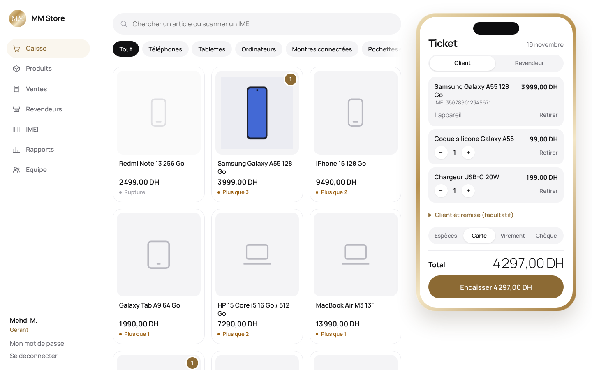
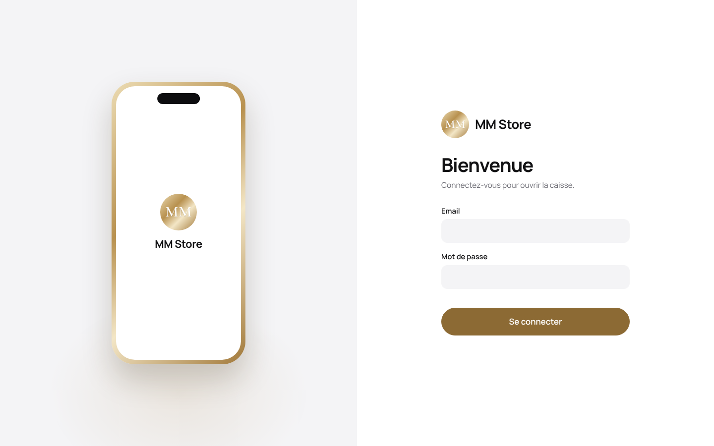
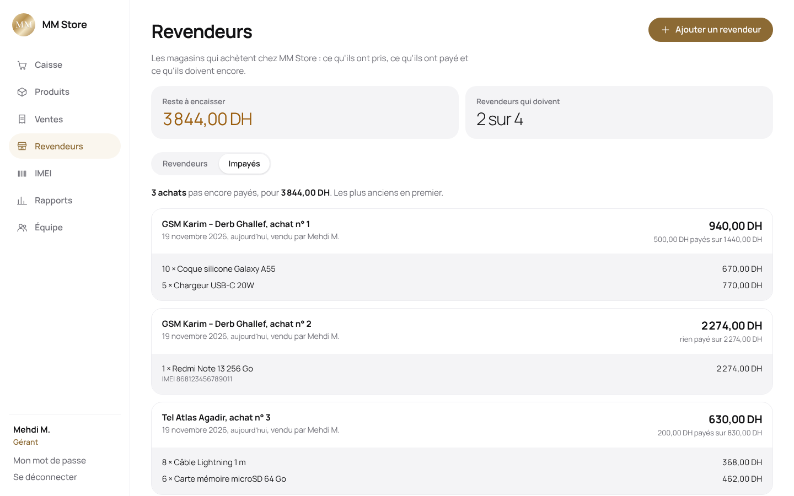
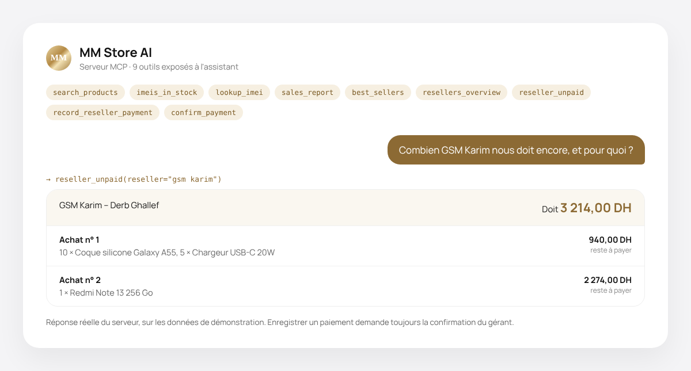

# MM Store: point of sale, inventory and an AI assistant for a phone & computer store

A full-stack system built for a family-owned phone, computer and accessories store in Morocco: a till, stock and
IMEI tracking, resellers who buy on credit, reports, and an **AI assistant** (an MCP server) that answers the
owner's questions from live store data. The interface is in French; prices are in dirhams (DH).


**Stack:** Python · FastAPI · SQLAlchemy 2.0 · PostgreSQL · Alembic · JWT auth · pytest · Docker · Caddy · GitHub Actions · vanilla JavaScript · Model Context Protocol (MCP)



| Login | What resellers took and haven't paid yet |
| --- | --- |
|  |  |

### MM Store AI: ask the store a question



The [`mm-store-ai/`](mm-store-ai/) folder is an MCP server that exposes the store to AI assistants as 9 typed
tools. The owner asks in French, Darija or English (*« Combien GSM Karim nous doit encore ? »*) and the assistant
answers from the real database. Anything that writes money data (recording a reseller's payment) needs the
person's confirmation first. The image above is the server's real answer on the demo data. Details:
[mm-store-ai/README.md](mm-store-ai/README.md).

## Features

- **Point of sale (Caisse):** tap product photos to fill the ticket; search by name, brand or scanned IMEI; category filters; discounts; 4 payment methods; printable receipt
- **Revendeurs (resellers):** other shops buying on credit at reseller prices; partial payment at the till, later payments, live balance, **what each shop took and hasn't paid yet** (purchase by purchase, oldest first, with products and IMEIs), printable account statement
- **17 product groups** (phones, cases, chargers, cables, adapters, memory cards…) shown in a set order, each with its own drawing when there's no photo; the manager can add or rename groups
- **Product photos:** upload or take a photo with a phone; the server checks, rotates, shrinks it to 800 px and strips location metadata
- **IMEI / serial number tracking:** every phone and computer is tracked as an individual unit, from delivery to sale; look up any IMEI to see when it arrived and who bought it (warranty, returns)
- **Stock management:** deliveries, manual adjustments with a required reason, low-stock alerts, and a full history of every stock movement (who, what, when, why)
- **Sales:** history with filters; cancellations (returns) that put stock and IMEIs back automatically
- **Reports:** daily revenue, gross margin, breakdown by payment method, revenue per day, best-selling products
- **Roles:** *admin* (manager) and *vendeur* (seller). Sellers can't see purchase prices, margins, reports or other sellers' sales.

## Engineering highlights

| Problem | Solution |
| --- | --- |
| Two sellers sell the last phone at the same moment | Stock is taken with one atomic conditional `UPDATE … WHERE quantity >= n`. A test fires 10 simultaneous requests at the last unit on PostgreSQL: exactly 1 succeeds. The naive read-then-write version sold it 10 times. |
| A sale fails halfway (item 3 out of stock) | Each sale is one database transaction: all-or-nothing rollback of stock, IMEIs, movements and the sale itself |
| Floating-point money errors | All amounts are integer centimes |
| Morocco changed time zone (UTC+1 → UTC+0, Sept 2026) | Times are stored in UTC; reports convert with official IANA rules (`zoneinfo`), never a hard-coded offset |
| Schema changes in production | Alembic migrations, plus a test that fails if `models.py` and the migrations ever disagree |
| Changing a price must not rewrite past receipts | Price and cost are copied onto each sale line |
| Uploaded "photos" could be anything (scripts, huge images, GPS metadata) | Every upload is decoded and re-encoded by Pillow: non-images refused, size and pixel limits, EXIF removed, random server-side file names |
| What a reseller owes must never drift out of sync | The balance is never stored: always computed as non-cancelled purchases minus payments, so cancelling a sale removes it from the debt automatically |
| Someone guesses passwords | Login limits per account and per network address (5 / 20 failures in 15 min) |
| A fired employee keeps a valid token | The user is re-checked on every request; deactivation takes effect immediately |

**92 automated tests** run on every push (GitHub Actions): 75 for the store, against both SQLite and a real PostgreSQL, and 17 for the AI server, which run the real store app in-process.

## Quick start (local, no Docker)

```bash
python -m venv .venv && source .venv/bin/activate        # Windows: .venv\Scripts\activate
pip install -r requirements-dev.txt
alembic upgrade head                                      # creates the tables (SQLite file by default)
python -m app.cli create-admin --email gerant@boutique.ma --name "Gérant"
python -m app.cli seed-demo                               # optional: demo products + seller account
uvicorn app.main:app --reload
```

Open **http://localhost:8000** for the app and **http://localhost:8000/docs** for interactive API docs.
Log in with `gerant@boutique.ma` and the password you chose, or as the demo seller `vendeur@demo.ma` / `vendeur123`.
Run the tests with `pytest` (store) and `cd mm-store-ai && pip install -e ".[dev]" && pytest` (AI server).

## Production (one store, online, HTTPS)

On a fresh Ubuntu 24.04 server: clone the repo to `/opt/mmstore`, then `bash deploy/setup-server.sh`. It installs Docker, opens only SSH/HTTP/HTTPS, generates the secrets, starts PostgreSQL + the app + Caddy (automatic HTTPS), creates the manager account and schedules nightly backups. Updates: `bash deploy/update.sh`. Restore test: `bash deploy/restore.sh --check <file>`.

## Docker on your own computer

```bash
cp .env.example .env          # then fill in SECRET_KEY and POSTGRES_PASSWORD
docker compose up -d --build
docker compose exec api python -m app.cli create-admin --email gerant@boutique.ma --name "Gérant"
```

See [GUIDE.md](GUIDE.md) for deployment, backups and a full walkthrough of the code.

## Project structure

```
app/
  main.py            app setup, French validation errors, serves the web interface
  config.py          settings from environment variables
  database.py        database connection, one session per request
  models.py          tables: User, Category, Product, SerialUnit, Sale, SaleItem, StockMovement
  schemas.py         request/response validation (Pydantic)
  security.py        bcrypt passwords, JWT tokens, role checks
  stock.py           shared stock helpers
  images.py          photo checks, resizing, metadata removal
  ledger.py          which reseller purchases are still unpaid (payment allocation)
  timeutils.py       store-local days ↔ UTC
  cli.py             create-admin, seed-demo
  routers/           API endpoints: auth, users, categories, products, serials, sales, resellers, reports
  static/            French web interface (HTML, CSS, JavaScript)
migrations/          Alembic database migrations
tests/               pytest suite (incl. concurrency and migration tests)
deploy/              production: one-command server setup, backups, restore check, updates
mm-store-ai/         MCP server: the AI assistant's tools, with its own tests and guide
```

---

### En bref (français)

Application de gestion pour magasin de téléphones, ordinateurs et accessoires : caisse, suivi des IMEI,
stock, historique des mouvements, annulations, rapports (chiffre d'affaires, marge, modes de paiement),
comptes administrateur et vendeur. Voir « Quick start » ci-dessus pour l'installation.
